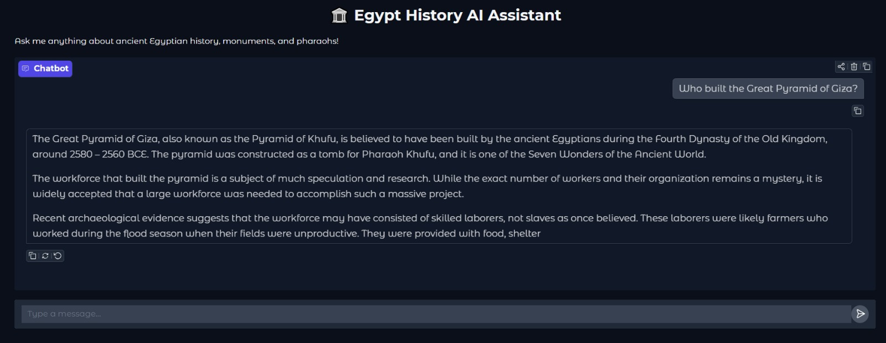
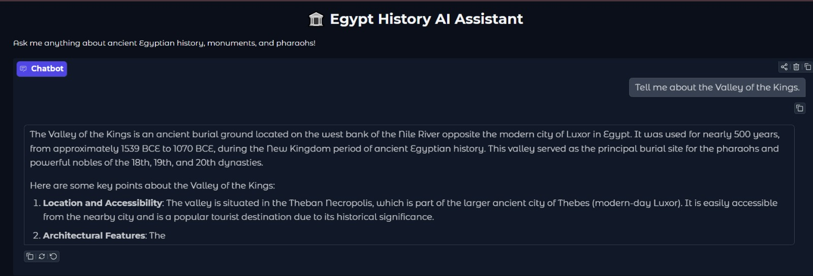

# 🏛️ Egypt History AI Assistant (Phi-3.5 QLoRA)

An end-to-end MLOps project demonstrating the fine-tuning, tracking, and deployment of a Large Language Model (LLM) specialized in **Egyptian History**.

This project fine-tunes the `microsoft/Phi-3.5-mini-instruct` model using **QLoRA** to answer questions accurately about ancient Egyptian monuments, pharaohs, and historical sites.

## 🔗 Project Links
*   **Hugging Face Model (LoRA Adapter):** [Manar-Abdelgawad/phi-egypt-history-qlora](https://huggingface.co/Manar-Abdelgawad/phi-egypt-history-qlora)

---


### Chatbot Inference & Testing (Gradio)


### Model Inference & Testing


### Experiment Tracking (Weights & Biases)


---

## Technical Stack & Architecture
*   **Base Model:** `microsoft/Phi-3.5-mini-instruct` (3.8B parameters)
*   **Fine-Tuning Framework:** LLaMA-Factory
*   **Methodology:** QLoRA (4-bit quantization + LoRA) to fit training on a free Google Colab T4 GPU.
*   **Experiment Tracking:** Weights & Biases (W&B)
*   **GUI/Frontend:** Gradio (for interactive chat)

## Training Details
The model was trained on a custom-curated dataset of 200 high-quality English Q&A pairs focusing on Egyptian historical sites.
*   **LoRA Rank (r):** 16
*   **Learning Rate:** 1e-4
*   **Epochs:** 3.0
*   **Final Training Loss:** ~0.68

---

##  How to Run Locally

### 1. Clone the repository
```bash
git clone https://github.com/ManarAbdelgawad/finetune-Egypt-History.git
cd finetune-Egypt-History